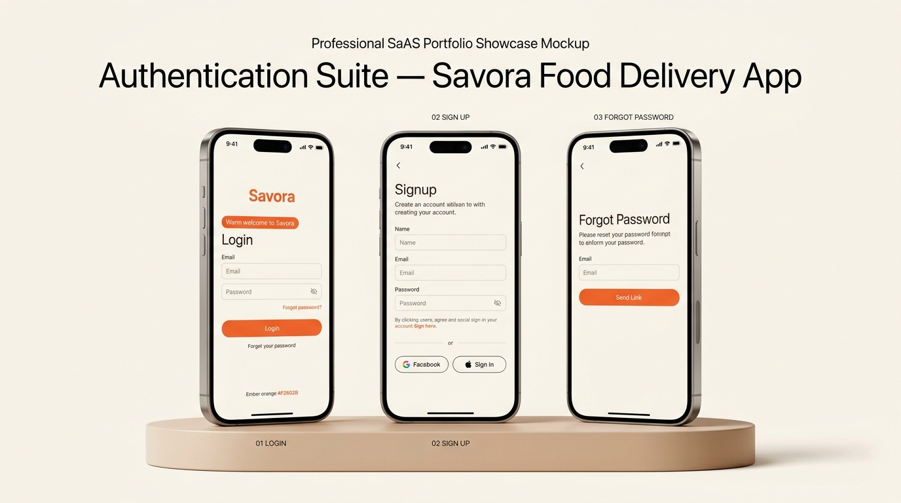
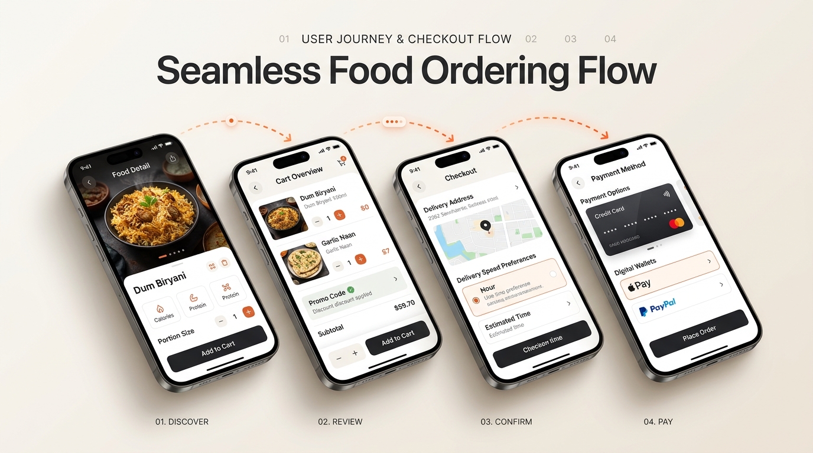
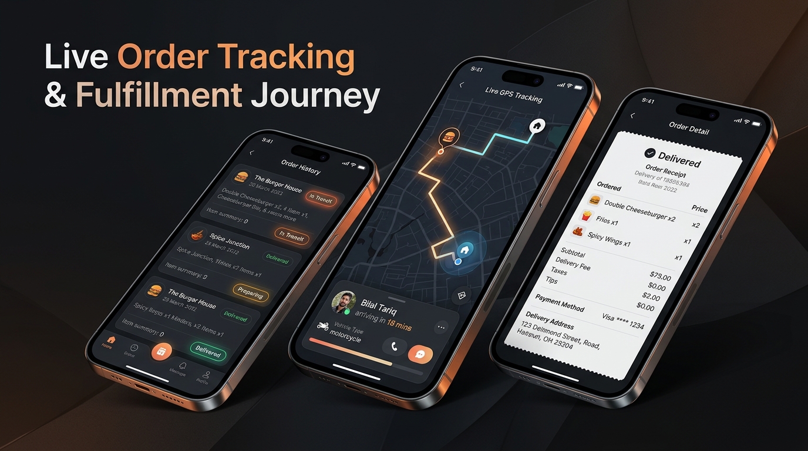
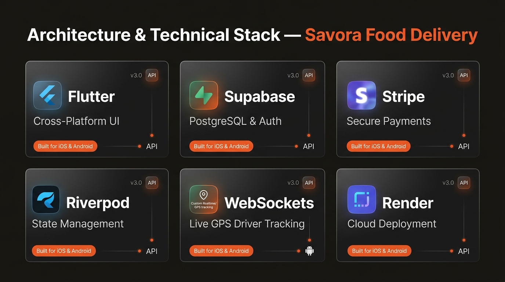

# Savora - Portfolio-Grade Food Delivery Application

A production-ready food delivery mobile & web application engineered with **Flutter**, **Riverpod**, **GoRouter**, **Supabase**, and a dedicated **Stripe Payment Backend** deployed on **Render**.


---

## 📱 App UI Showcase

| Authentication Suite | Discovery & Catalog | Checkout Journey |
| :---: | :---: | :---: |
|  |  |  |

| Live Order Tracking | System Architecture | Portfolio Showcase |
| :---: | :---: | :---: |
|  |  |  |

---

## 🏛 Architecture Overview

Savora adopts a strict **Feature-First + Repository Pattern** architecture with clean separation of concerns:

- **Presentation Layer:** Riverpod StateNotifiers, AsyncNotifiers, and StreamProviders decoupled from UI widgets.
- **Routing Layer:** Declarative GoRouter routing with automatic authentication guards and real-time refresh streams.
- **Domain & Data Layer:** Repositories abstracting all REST, WebSocket Realtime, and database operations.
- **Backend Service:** Independent Node.js / Express microservice ensuring **Stripe secret keys are never exposed to the client** and webhooks serve as the sole source of truth for payment confirmations.

```
Food Delivery App/
├── lib/
│   ├── core/
│   │   ├── config/              # Environment & Supabase initialization
│   │   ├── constants/           # Warm Culinary Modern design tokens
│   │   ├── errors/              # App failure & exception models
│   │   ├── routing/             # GoRouter configuration & guards
│   │   └── utils/               # Refresh streams & helpers
│   ├── features/
│   │   ├── auth/                # Sign-in, Sign-up, Password reset, Profile
│   │   ├── food/                # Catalog, Categories, Search, Favorites
│   │   ├── cart/                # Cart state & pricing calculations
│   │   ├── order/               # Checkout, History, Realtime Tracking
│   │   └── payment/             # Stripe payment flow & status synchronizer
│   └── main.dart                # Application entrypoint
├── server/                      # Stripe Payment & Webhook Microservice
│   ├── src/
│   │   ├── config/              # Environment loader
│   │   ├── controllers/         # Payment & Webhook controllers
│   │   ├── routes/              # Health & API route definitions
│   │   ├── services/            # Stripe & Supabase service layer
│   │   └── index.js             # Express server entrypoint
│   ├── Dockerfile               # Production container image
│   ├── render.yaml              # Render blueprint deployment spec
│   └── package.json
└── supabase/
    └── migrations/              # Production-grade SQL DDL & RLS policies
```

---

## 💳 Stripe Integration Flow (Single Source of Truth)

```
[Flutter Client] ────(1) POST /create-payment-intent────> [Savora Backend]
       │                                                         │
       │                                                    (2) Calls Stripe API
       │                                                         │
       ▼                                                         ▼
[User confirms card] ────(3) Authorizes Payment───────────> [Stripe Engine]
       │                                                         │
       │                                                 (4) Sends Webhook Event
       │                                                         │
       ▼                                                         ▼
[Flutter listens] <────(6) Realtime event update───── [Backend verifies & updates DB]
```

1. **Client Request:** When an order is placed, Flutter requests a `PaymentIntent` from the Savora server.
2. **Server-Side Generation:** Savora server computes the amount in cents and creates the intent using `STRIPE_SECRET_KEY`.
3. **Card Authorization:** Client collects card details securely; credentials never touch application servers.
4. **Stripe Webhook:** Upon authorization, Stripe dispatches a signed `payment_intent.succeeded` event to `/api/webhook`.
5. **Database Update:** The server verifies the cryptographic signature with `STRIPE_WEBHOOK_SECRET` and marks `orders.payment_status = 'paid'`.
6. **Realtime Sync:** Supabase Realtime notifies Flutter of the verified status, moving the user to the confirmed tracking screen.

---

## 🔐 Environment Variables

### Flutter App (`.env`)
```env
SUPABASE_URL=https://your-project.supabase.co
SUPABASE_ANON_KEY=your-publishable-key
BACKEND_URL=http://localhost:3000   # Or your Render URL
STRIPE_PUBLISHABLE_KEY=pk_test_...
```

### Payment Server (`server/.env`)
```env
PORT=3000
NODE_ENV=production
ALLOWED_ORIGINS=*
SUPABASE_URL=https://your-project.supabase.co
SUPABASE_SERVICE_ROLE_KEY=your_service_role_key
STRIPE_SECRET_KEY=sk_test_...
STRIPE_WEBHOOK_SECRET=whsec_...
```

---

## 🚀 Running the Project

### 1. Run Flutter Application
```bash
flutter pub get
flutter run -d chrome
```

### 2. Run Payment Backend Locally
```bash
cd server
npm install
npm run dev
```
Health endpoint: `http://localhost:3000/health`
